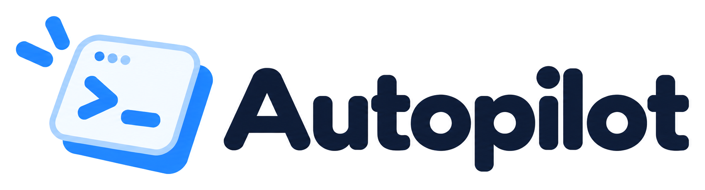
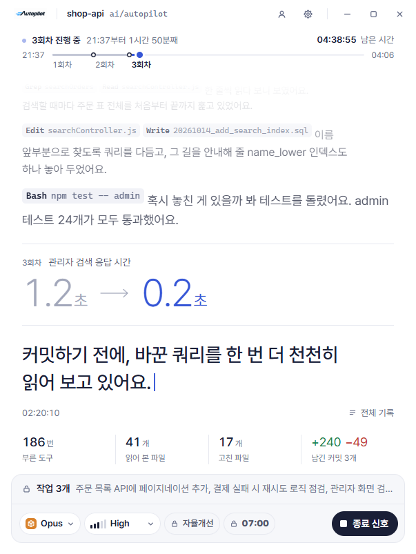
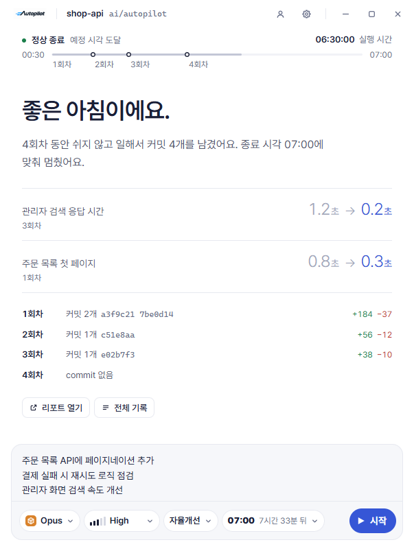

<p align="center">
  
</p>

<p align="center">
  <strong>개발자가 자리를 비운 사이에도, 프로젝트는 앞으로.</strong><br>
  Claude Code로 코드 수정부터 검증, 커밋까지 반복하는 Windows 자동 개발 앱
</p>

<p align="center">
  <a href="https://github.com/ReguMaster/Autopilot/releases/latest"><strong>Windows 다운로드</strong></a>
  &nbsp;·&nbsp;
  <a href="#시작하기">시작하기</a>
  &nbsp;·&nbsp;
  <a href="https://github.com/ReguMaster/Autopilot/issues">의견 남기기</a>
</p>

<p align="center">
  
</p>

## AutoPilot은 무엇인가요?

해야 할 작업과 종료 시각을 정하고 **시작**을 누르세요. AutoPilot은 Claude Code를 활용해 작업을 이어가고, 수정 사항을 검증한 뒤 Git 커밋과 리포트로 남깁니다.

작업을 직접 지정할 수도 있고, 개선할 부분을 스스로 찾도록 맡길 수도 있습니다.

**작업 선택 → 코드 수정 → 검증 → 커밋 → 기록 → 다음 작업**

## 주요 기능

- **자율 개발** — 지시한 작업을 끝낸 뒤에도 버그, 안정성, 성능 등 개선점을 찾아 작업합니다.
- **작업별 커밋** — 검증을 통과한 변경을 작업 단위로 커밋해 결과를 쉽게 검토할 수 있습니다.
- **종료 시각 설정** — 원하는 시각까지 실행하고, 앱을 닫아도 시스템 트레이에서 계속 동작합니다.
- **작업 이어하기** — 중단된 프로젝트를 다시 열면 기록을 바탕으로 진행을 이어갑니다.
- **실시간 진행 상황** — 현재 작업, 수정 파일, 테스트, 커밋과 결과를 화면에서 확인할 수 있습니다.
- **사용량 관리** — Claude 사용량과 재설정 시각을 확인하고, 한도에 걸리면 대기 후 재개합니다.

## 시작하기

**필요한 것:** Windows 64비트, [Git](https://git-scm.com/), [Claude Code](https://docs.anthropic.com/en/docs/claude-code/overview)

1. [최신 릴리스](https://github.com/ReguMaster/Autopilot/releases/latest)에서 설치형(`Setup`) 또는 무설치형(`Portable`)을 다운로드합니다.
2. AutoPilot을 실행하고 **Git 프로젝트 폴더**를 선택합니다. (최소 1개의 커밋 필요)
3. 작업 내용, 모델, 개선 방식, 종료 시각을 정하고 **시작**을 누릅니다.
4. 실행을 마치면 리포트와 `ai/autopilot` 브랜치의 커밋을 검토합니다.

> AutoPilot은 클라우드에서 실행되는 서비스가 아닙니다. 작업하는 동안 **PC가 켜져 있어야** 하며, Claude Code 사용 권한이 필요합니다.

## 원하는 방식으로 작업하세요

| 모드         | 동작                                                              |
| ------------ | ----------------------------------------------------------------- |
| **자율개선** | 지정한 작업을 완료한 뒤에도 스스로 개선점을 찾아 계속 작업합니다. |
| **지시개선** | 지정한 작업만 처리하고 완료되면 종료합니다.                       |

<p align="center">
  
  
</p>

## Git 기록을 지키며 작업합니다

- 변경 사항은 별도 **`ai/autopilot` 브랜치**에 커밋합니다.
- 삭제 대상 파일은 `.autopilot/recycle_bin`으로 옮겨 복구할 수 있도록 합니다.
- 실행 기록, 커밋, 소요 시간과 비용을 리포트로 확인할 수 있습니다.
- 프로젝트의 `CLAUDE.md`에 추가 규칙을 작성할 수 있습니다.

> [!WARNING]
> AutoPilot은 Claude Code 명령 실행 시 매번 승인을 요청하지 않습니다. 중요한 데이터는 백업하고, 신뢰할 수 있는 프로젝트에서 사용하세요. 자동 생성된 변경은 병합 전에 직접 검토해야 합니다.

## 개발자를 위한 정보

소스에서 실행하거나 빌드하려면 **Node.js 22.12 이상**이 필요합니다.

```bash
npm ci
npm start       # 데스크톱 앱 실행
npm test        # 스모크 테스트
npm run dist    # Windows 설치형·포터블 빌드
```

자세한 구조와 개발 규칙은 [CLAUDE.md](CLAUDE.md)와 [desktop/README.md](desktop/README.md)를 참고하세요.

---

<p align="center">
  버그 제보와 기능 제안은 <a href="https://github.com/ReguMaster/Autopilot/issues">GitHub Issues</a>에서 받습니다.
</p>
