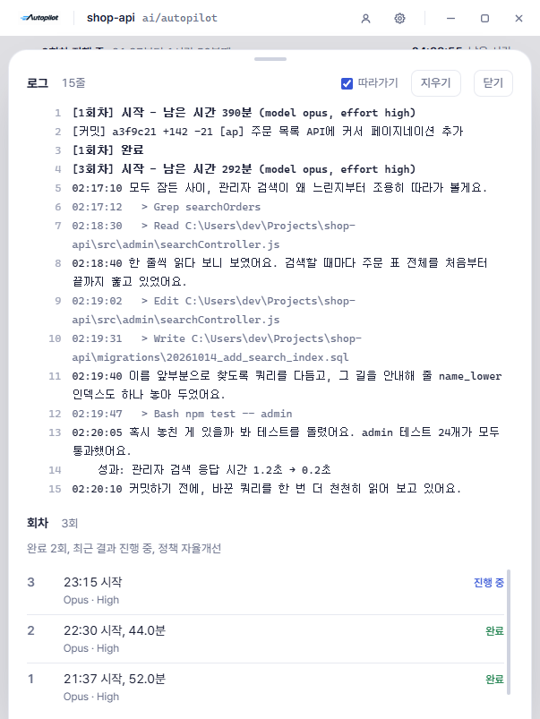
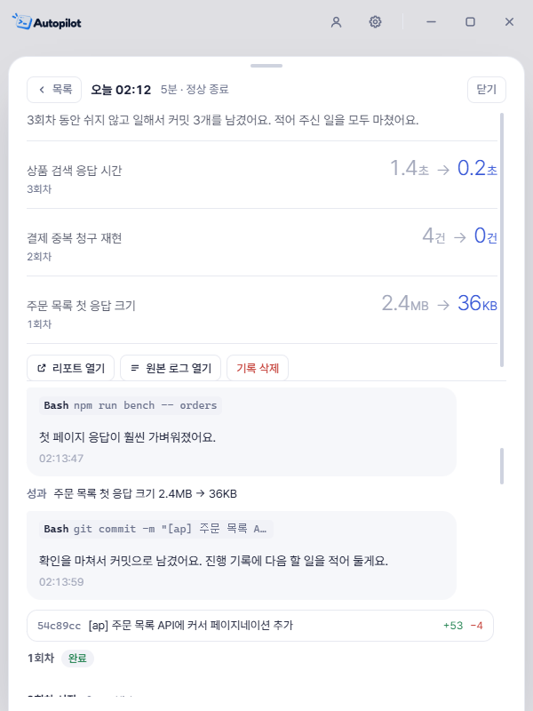
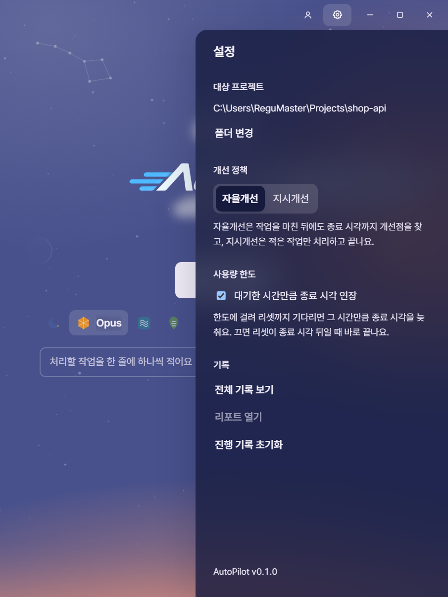
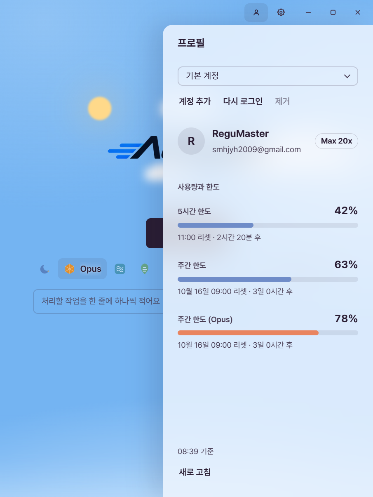

<p align="center">
  
</p>

<p align="center">
  <b>자리를 비우기 전에 시작을 누르면, 돌아왔을 때 검증된 commit이 쌓여 있습니다.</b><br>
  Claude Code가 정해 둔 시각까지 프로젝트를 스스로 개선하는 Windows 데스크톱 앱
</p>

| 시작 전 | 실행 중 | 마친 뒤 | 전체 기록 |
| :-: | :-: | :-: | :-: |
|  |  |  |  |

## AutoPilot은

할 일을 적고 종료 시각을 정한 뒤 **시작**을 누르면, Claude가 그 시각까지 아래 과정을 반복합니다.

1. 적어 둔 작업을 위에서부터 처리하고, 다 끝나면 스스로 고칠 곳을 찾습니다.
2. 고친 내용을 테스트로 확인합니다.
3. 확인을 마친 작업 하나를 commit 하나로 남기고, 무엇을 했는지 기록해 다음 차례로 넘깁니다.

모든 작업은 `ai/autopilot` 브랜치에만 쌓입니다. 돌아와서 리포트와 commit을 훑어보고 마음에 드는 것만 가져가면 됩니다.

## 주요 기능

### 적고, 고르고, 시작

- 시작 화면은 시각과 프로젝트에 맞춰 "오늘 밤에는 Kirikomodo에 무엇을 해 둘까요?"처럼 인사하고, 그 아래에 최근 실행 3개를 보여줍니다.
- 작업 칸에 한 줄에 하나씩 적으면 위에서부터 차례로 처리합니다.
- 모델(Fable · Opus · Sonnet · Haiku), Effort(Low ~ Max), 개선 정책, 종료 시각을 작업 칸 아래 버튼으로 바로 고릅니다. 종료 시각은 시 · 분을 올리고 내리거나 1 · 3 · 6시간 뒤, 기본 07:00 중에서 고릅니다.
- 입력한 값은 다음에 앱을 켤 때 그대로 남아 있습니다.

### 밤새 돌려도 흐트러지지 않습니다

- 일을 짧은 차례(회차)로 나누고 매번 새로 시작합니다. 대화가 길어져 판단이 흐려지는 일이 없습니다.
- 회차마다 진행 상황을 기록해 두고 다음 회차가 이어받습니다. 중간에 PC가 꺼져도 같은 프로젝트로 다시 시작하면 하던 일을 이어갑니다.
- 종료 시각을 지킵니다. 남은 시간이 20분보다 적으면 새 작업을 시작하지 않고, 한 회차가 2시간을 넘기면 끊습니다.
- 더 할 일이 없으면(두 회차 연속으로 commit이 없으면) 종료 시각 전이라도 알아서 끝냅니다.
- 실행 중에는 PC 절전을 막고, 창을 닫으면 트레이로 숨어 계속 돕니다. 종료 · 실패 · 사용량 한도 대기는 Windows 알림으로 알려줍니다.

### 실행 중에도 조절할 수 있습니다

- 모델과 Effort는 실행 중에도 바꿀 수 있고, 지금 회차가 끝난 뒤 다음 회차부터 적용됩니다. 기다리는 값은 "적용 대기"로 표시됩니다.
- 실행이 시작되면 작업 칸은 작업 요약 한 줄로 접힙니다. 누르면 적어 둔 작업을 펼쳐 볼 수 있습니다.
- **종료 신호**는 실수로 누르지 않도록 한 번 누르면 붉게 바뀌고, 4초 안에 한 번 더 눌러야 보냅니다. 하던 회차를 마치고 끝내며, 그 뒤에 나타나는 **종료**는 확인을 거쳐 바로 멈춥니다.
- 앱을 다시 켰을 때 그 프로젝트에서 AutoPilot이 아직 돌고 있으면 자동으로 다시 연결합니다.

### 지금 무엇을 하는지 말로 들려줍니다

- Claude가 지금 하는 일을 큰 문장 하나로 들려주고, 지난 문장은 위로 올라가며 흐려집니다. 문장을 남기기 전에 파일을 읽거나 고치는 동안에는 "searchController.js 파일을 차근차근 읽어 보고 있어요"처럼 앱이 대신 알려 줍니다.
- 테스트로 확인한 성과(예: 응답 시간 1.2초 → 0.2초)는 크게 보여주고, 부른 도구, 읽어 본 파일, 고친 파일, 남긴 커밋과 바뀐 줄 수가 함께 쌓입니다.
- 위쪽 진행선에 회차 구간과 커밋이 찍히고, 종료 시각까지 남은 시간이 흐릅니다.
- 실행을 마치면 회차별 커밋과 성과를 한 화면에 정리해 보여줍니다. **전체 기록**을 누르면 전체 로그와 회차별 결과가 펼쳐지고, **처음으로**를 누르면 시작 화면으로 돌아갑니다.
- 리포트에는 회차별 결과, 걸린 시간, 비용, commit과 바뀐 규모가 한 장에 정리됩니다. 실행 중에도 계속 갱신되며 마친 화면이나 설정의 **리포트 열기**로 엽니다.

### 지난 실행을 다시 봅니다



- 시작 화면의 **지난 실행**이나 **전체 보기**를 누르면 이 프로젝트의 지난 실행 목록이 열립니다. 시작 시각, 걸린 시간, 종료 상태(정상 종료 · 중단됨 · 한도로 멈춤 · 오류 종료)와 마지막 성과를 보여줍니다.
- 하나를 고르면 그날의 작업이 대화처럼 이어집니다. 회차 시작, Claude의 문장과 앞서 부른 도구, 성과, commit, 회차 결과가 시간 순으로 나옵니다.
- 위쪽에서 리포트와 원본 로그를 열 수 있고, **기록 삭제**로 그 실행의 로그와 리포트만 지울 수 있습니다(commit과 진행 기록은 그대로입니다).
- 기록은 프로젝트의 로그를 그대로 읽으므로 앱을 껐다 켜도 남아 있고, 30일이 지나면 로그와 함께 정리됩니다. 앱이나 PC가 꺼져 끝맺음 없이 끊긴 실행도 읽을 수 있는 부분까지 보여줍니다.

<br clear="right">

### 사용량 한도까지 챙깁니다

- 프로필 패널에서 Claude 구독의 5시간 한도와 주간 한도(모델별 주간 한도가 있으면 함께) 사용률, 리셋 시각을 확인합니다. 실행 중에는 5시간 한도 막대가 파랗게 흐릅니다.
- Claude 계정을 여러 개 등록해 두고 실행할 계정을 고를 수 있습니다. 한 계정의 한도가 찼다면 다른 계정으로 바꿔 시작하면 됩니다.
- 한도에 걸리면 실패로 치지 않고 리셋될 때까지 기다렸다가 이어갑니다. 설정에서 **대기한 시간만큼 종료 시각 연장**을 켜면 기다린 만큼 늦게 끝납니다.
- 오류가 나면 5분 · 15분 · 30분 뒤에 다시 시도하고, 그래도 안 되면 헛돌지 않고 멈춥니다. Opus가 응답하지 못하면 Sonnet으로 넘어갑니다.

## 맡겨도 안전하게

- 작업은 `ai/autopilot` 브랜치에서만 합니다. 브랜치가 없으면 `main`에서 새로 만듭니다.
- 확인을 마친 작업 하나가 commit 하나가 되므로, 마음에 들지 않는 변경은 commit 단위로 버리면 됩니다. commit 메시지에는 `[ap]`가 붙습니다.
- 파일을 지우지 않습니다. 지워야 할 파일은 프로젝트의 `.autopilot/recycle_bin`으로 옮겨 두므로 언제든 되살릴 수 있습니다.
- Git 기록을 지우거나 덮어쓰는 명령, 운영 서버·DB 조작, 인증 정보 변경, 새 외부 서비스나 라이브러리 추가는 하지 않습니다.
- 의도를 모르는 코드, 영향 범위를 알 수 없는 변경, 확인할 방법이 없는 변경은 건너뛰고 다른 작업을 고릅니다.
- 프로젝트마다 지켜야 할 규칙이 있다면 그 프로젝트의 `CLAUDE.md`에 적어 두세요. Claude가 그 내용을 따릅니다.

> [!WARNING]
> Claude는 명령을 실행할 때마다 허락을 묻지 않습니다. **믿을 수 있는 프로젝트에서만** 사용하세요.

## 시작하기

### 준비물

- Windows (64비트)
- [Git](https://git-scm.com/)
- Claude Code: 설치해 두세요. 로그인돼 있지 않으면 시작할 때 나오는 **로그인** 버튼으로 바로 로그인할 수 있습니다.

### 설치

[Releases](../../releases)에서 둘 중 하나를 받아 실행합니다.

- `AutoPilot-Setup-<버전>-x64.exe`: 설치형입니다. 실행이 빠릅니다.
- `AutoPilot-Portable-<버전>-x64.exe`: 설치 없이 바로 실행합니다. 실행할 때마다 임시 폴더에 풀어서 시작이 느립니다.

게시자 서명이 없어 처음 실행할 때 Windows가 경고할 수 있습니다. **추가 정보 → 실행**을 누르세요.

새 버전이 나오면 헤더 오른쪽에 `↑ v1.2.0` 같은 칩이 나타나고, 누르면 릴리스 페이지가 열립니다. 자동으로 설치하지는 않습니다.

### 사용법

1. 처음 켜면 화면 아래 안내의 **폴더 선택**으로 맡길 프로젝트를 고릅니다(나중에는 오른쪽 위 **설정**(톱니바퀴)에서 바꿉니다). Git 저장소의 최상위 폴더여야 하고, commit이 하나 이상 있어야 합니다.
2. 화면 아래 카드의 칸에 할 일을 적고, 카드 아래 버튼으로 모델, Effort, 개선 정책, 종료 시각을 고릅니다. 할 일을 비워 두면 Claude가 스스로 개선할 곳을 찾습니다.
3. 카드 오른쪽 아래의 **시작**을 누릅니다.
4. 끝나면 화면에 정리된 성과와 회차별 commit, **리포트 열기**로 결과를 보고 `ai/autopilot` 브랜치의 commit을 검토합니다.

### 설정과 프로필

| 설정 | 프로필 |
| :-: | :-: |
|  |  |
| Claude 데이터 폴더, 대상 프로젝트, 한도 대기 연장과<br>전체 기록 · 지난 실행 · 리포트 · 진행 기록 초기화 | 실행할 계정 선택 · 추가와 구독 사용량.<br>70%를 넘으면 주황, 90%를 넘으면 빨강으로 바뀝니다 |

사용량을 불러오지 못해도 실행에는 영향이 없습니다.

### 개선 정책

| 정책 | 동작 |
| --- | --- |
| 자율개선 (기본) | 적은 작업을 마친 뒤에도 종료 시각까지 스스로 개선점을 찾아 계속합니다. |
| 지시개선 | 적은 작업만 처리하고, 다 끝나면 시간이 남아도 바로 끝냅니다. 작업을 하나 이상 적어야 시작할 수 있습니다. |

자율개선이 스스로 일을 고를 때는 버그 → 안정성 → 데이터 손상 위험 → 성능 → 기능 완성도 → 유지보수성 → UX → 코드 정리 순으로 살핍니다.

### 기본값

| 항목 | 기본값 |
| --- | --- |
| 종료 시각 | 07:00 (이미 지난 시각이면 다음 날) |
| 개선 정책 | 자율개선 |
| 모델 | Opus |
| Effort | High |

## 자주 묻는 질문

**언제 끝나나요?**\
종료 시각이 되면 끝납니다. 지시개선에서 작업을 다 마쳤을 때, 두 회차 연속으로 바뀐 것이 없을 때, 오류가 계속될 때는 더 일찍 끝납니다. 종료 시각에 하던 회차도 멈추며, commit하지 못한 변경은 프로젝트에 그대로 남겨 둡니다.

**대상 프로젝트에 무엇이 생기나요?**\
`.autopilot` 폴더 하나가 생깁니다. 로그와 리포트, 옮겨 둔 파일(`recycle_bin`)이 들어 있고 Git에는 잡히지 않습니다. 로그와 리포트는 30일이 지나면 자동으로 정리됩니다.

**처음부터 새로 시작하고 싶어요.**\
진행 기록은 프로젝트 밖에 따로 보관되어 같은 프로젝트를 다시 실행하면 이어집니다. 새로 시작하려면 설정의 **진행 기록 초기화**를 누르세요. 기존 기록은 프로젝트의 `.autopilot` 폴더에 보관됩니다. 작업을 모두 마치고 끝난 실행은 자동으로 초기화됩니다.

**Claude가 한 일을 자세히 보고 싶어요.**\
지난 실행, 리포트, 전체 기록에서 회차별로 확인할 수 있습니다. 한 회차의 대화 전체는 로그에 나오는 세션 ID로 프로젝트 폴더에서 `claude --resume <세션 ID>`를 실행해 열어 봅니다.

## 개발

소스에서 실행하거나 직접 빌드하려면 Node.js 22.12 이상이 필요합니다.

```sh
npm ci
npm start      # 앱 실행
npm run dist   # dist/에 설치형 · 포터블 exe 생성
```

구조와 검증 명령, 개발 규칙은 [CLAUDE.md](CLAUDE.md)와 [desktop/README.md](desktop/README.md)에 있습니다.
